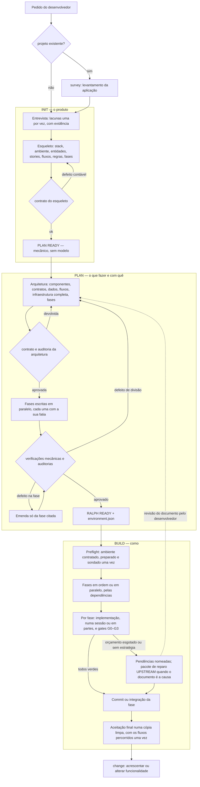
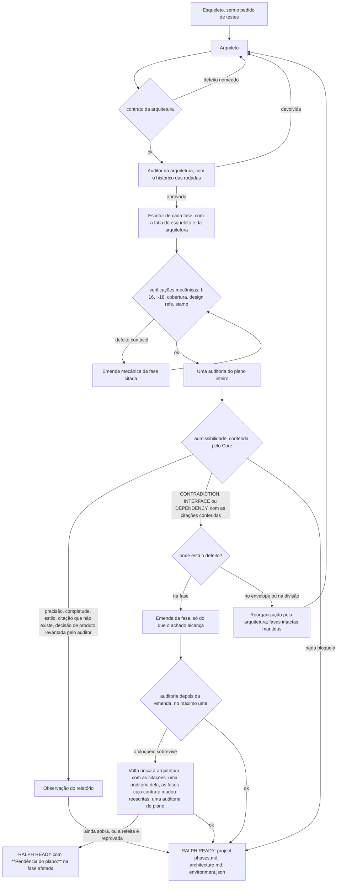
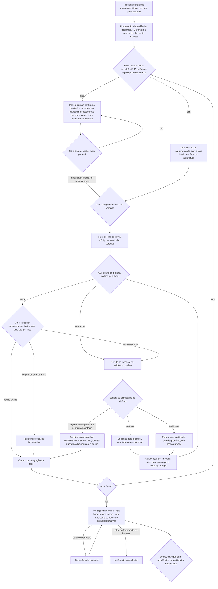

# O contrato da Capivara — INIT, PLAN e BUILD

Versão **0.8.0** (com a execução progressiva das fases, §130, a preparação, o raciocínio e o catálogo de modelos do §131, o produto fora do navegador do §133, o percurso de terminal da §134, a adoção da preparação pelo contrato do PLAN da §135 e a redução da verificação da §138: o plan de uma passada, uma revisão por fase, os fluxos só na aceitação final e os estados da entrega). Este documento descreve, num lugar só, o que cada estágio da
Capivara recebe, decide, produz e não pode fazer, e como o trabalho passa de um
para o outro. O porquê de cada regra está numerado em `docs/PLANO.md` (§NNN); o
estado do trabalho, em `docs/HANDOFF.md`. Quando este documento e o código
divergirem, vale o código, e este documento está errado.

## O princípio

| estágio | responde | com quem |
|---|---|---|
| **INIT** | **o quê**: o produto, completo e sem lacunas | o desenvolvedor, por entrevista |
| **PLAN** | **o que fazer e com quê**: arquitetura, infraestrutura completa, fases e tasks de implementação com critérios funcionais | ninguém novo: lê o INIT, pergunta ao desenvolvedor só decisão de produto |
| **BUILD** | **como**: implementa, executa e verifica, usando só o que o PLAN contratou | ninguém novo: lê o PLAN e reporta o que o plano não permite |

Três regras atravessam os três estágios:

1. **A autoridade é do desenvolvedor.** O pedido original e as respostas aceitas na
   entrevista mandam; nenhum papel do harness torna opcional uma decisão dele nem
   decide por ele uma questão de produto.
2. **O objetivo é concluir.** Cada estágio procura o caminho para terminar dentro
   dos limites que já existem; parar é o último recurso, sempre retomável e com
   diagnóstico. Nunca se aprova o que não foi verificado: o que não se provou é
   entregue como pendência nomeada, nunca como aceito.
3. **Quem escreve não aprova o que escreveu.** Escritor, auditor e verificador são
   sessões e papéis separados; o reparo é provado pela suíte, e o achado reparado
   que nenhuma leitura reviu fica como pendência.

## Fluxograma geral

## Quem decide o quê

| assunto | INIT | PLAN | BUILD |
|---|---|---|---|
| funcionalidades, entidades, campos, regras de negócio, fluxos | **decide**, com o desenvolvedor | aplica, nunca muda | implementa |
| stack (linguagem, framework, banco) | registra o que o pedido e a entrevista definem | detalha versões e dependências | usa |
| caminhos de arquivo, variáveis de ambiente, comandos, funções | não escreve, salvo se o pedido fixar (I-17) | **decide** (arquitetura e tasks) | implementa |
| componentes, contratos entre eles, divisão em fases | propõe fases preliminares | **decide**; pode dividir, fundir e reordenar | executa a divisão |
| quantas sessões do executor uma fase leva, e quais tasks vão em cada uma | — | define as tasks, os critérios e a ordem | **decide** a divisão em partes; nunca muda task, critério nem ordem |
| todas as dependências do projeto, as de teste incluídas | — | **decide** (infraestrutura) | instala as declaradas; nunca acrescenta, troca nem atualiza |
| o que o pedido diz sobre testes | **registra** em regras de assunto `testes.` | não carrega nem repete | **executa** |
| como testar, que testes, que ferramenta de teste usar dentre as contratadas | — | nunca | **decide** |
| ferramentas internas do harness (Playwright privado dos fluxos) | — | — | a Capivara as prepara em `.capivara/` |

## Os artefatos

| arquivo | escrito por | lido por | o que é |
|---|---|---|---|
| `.capivara/handoffs/pedido.json` | INIT | INIT, PLAN | o pedido original, verbatim |
| `.capivara/handoffs/<run>.*.json` | INIT, PLAN | INIT, PLAN | entrevista, decisões, estado do esqueleto e da arquitetura, cache do plano |
| `.capivara/init/skeleton.md` | INIT (e o PLAN, com a divisão da arquitetura aplicada) | PLAN, BUILD (Stack, Regras e Contratos, no contrato compartilhado) | o produto |
| `.capivara/init/architecture.md` | PLAN | BUILD (a fatia de cada fase) | componentes, contratos, dados, fluxos, infraestrutura, fases |
| `.capivara/init/project-phases.md` | PLAN | BUILD (o único documento que o loop consome) | as fases, as tasks e os critérios de aceite |
| `.capivara/init/environment.json` | PLAN | BUILD (preflight) | sondas de prontidão e infraestrutura, presas por hash ao esqueleto e ao plano |
| `.capivara/flows/` | BUILD (o roteirista da aceitação) | BUILD (aceitação final) | os roteiros dos fluxos, ferramenta do harness |
| `.capivara/runs/<run-id>/` | os três | o harness | plano de controle: eventos, prompts, logs, evidências; nunca entra num commit |
| `.capivara/repairs/` | BUILD | o desenvolvedor, o PLAN | pacotes de reparo documental (`UPSTREAM_REPAIR_REQUIRED`) |

Os documentos de `.capivara/init/` são certificados por stamp e hash: o BUILD não os
edita, e um documento mudado fora do PLAN invalida o `environment.json`.

## INIT

**Entra:** o pedido do desenvolvedor (texto, arquivo ou documento do doc-center) e
o inventário do diretório.

**Faz:**

1. **Entrevista.** Levanta as lacunas do pedido e pergunta uma de cada vez, com a
   evidência antes da pergunta, em até 3 rodadas. Cada resposta é classificada; só
   `ACCEPTED` vira decisão confirmada, e "não sei" nunca confirma a recomendação. A
   decisão de banco gera as regras de banco do harness (`.env`, `.env.example`,
   migração, banco dos testes, a aplicação escolhe o banco pelo ambiente).
2. **Esqueleto** (`capivara-skeleton/v2`): stack, sondas de ambiente, entidades com
   campos, stories, fluxos com passos, regras transversais (cada uma nomeia o alvo e
   o momento), fases preliminares com o que cada uma cobre, corte do MVP, o que
   ficou fora do escopo. Descreve o **produto**, nunca o mecanismo.
3. **O pedido de testes** fica em regras cujo assunto começa por `testes.`, nas
   palavras do desenvolvedor, e só nelas. O build as lê; o plano não.

**Verifica, contando (sem modelo):**

- cobertura: toda story, entidade e fluxo está no `covers` de alguma fase; fases
  contíguas, dependendo só das anteriores, cabendo numa sessão;
- I-16: nenhuma ferramenta, arquivo, trabalho ou procedimento de teste que o pedido
  não fixou; o pedido de testes fora das regras `testes.` volta ao escritor; o
  pedido que exige testes sem nenhuma regra `testes.` também volta;
- I-17: nenhum caminho, variável, comando, função ou mecanismo que o pedido não
  fixou.

O que se conserta contando é consertado em código (renumerar fases, normalizar
rótulos, apagar a entrada de stack que só escolhe ferramenta de teste). O resto
volta ao escritor nomeado; o mecanismo e o pedido de testes fora do lugar são
tolerados depois da escada, com ressalva no relatório, e nunca param o init.

**Sai:** `skeleton.md` e **PLAN READY**, que é mecânico: cobertura, ordem,
tamanho e nenhuma decisão material em aberto.

## PLAN

**Entra:** o esqueleto, as decisões do INIT e o pedido. O PLAN lê o esqueleto
**sem o pedido de testes** (`skeletonForPlanning`): sem as regras e a entrada de
stack de teste, sem a regra do banco dos testes, sem regra que seja toda sobre teste.

**Faz:**

1. **Arquitetura** (`capivara-architecture/v1`): componentes com responsabilidade e
   arquivos (um dono por arquivo), contratos (rotas com método, caminho, status e
   formato; funções com assinatura; tabelas), decisões de dados, fluxos pelos
   componentes, **infraestrutura completa** — runtimes, ferramentas, gerenciadores,
   dependências da aplicação e de desenvolvimento, **as de teste incluídas** (o
   runner da stack, Playwright para interface web), serviços, bancos,
   compatibilidade, pré-condições e sondas de prontidão, cada item com a autoridade
   da escolha — e a divisão de fases que vale. Toda fase cobre algo; o goal de uma
   fase promete só o que os componentes dela entregam. Sem versão no pedido, o
   runtime da máquina vale com a versão instalada (o inventário diz o Node e o npm
   que o harness roda), e a sonda de versão confere um mínimo. As sondas desse
   Node e desse npm rodam antes de a arquitetura valer, como o build as rodaria e
   sem modelo: a que a máquina não satisfaz volta ao arquiteto uma vez; se ele
   insistir, o `plan` para com a sonda e as versões da máquina.
2. **Fases**, uma chamada por fase, em paralelo, cada uma vendo só a sua fatia. Até
   15 tasks por fase, até 2 critérios por task e 30 por fase, dimensionadas pela
   complexidade efetiva para um executor econômico de contexto pequeno. As tasks
   nomeiam arquivo, rota e função; os critérios descrevem comportamento observável.
3. **Verificações mecânicas**, antes de qualquer modelo: I-16 (nenhum teste no
   plano: task, critério, condição ou procedimento de teste; a ferramenta só se o
   pedido, uma decisão ou a infraestrutura aprovada a nomeiam), I-18 (escrita
   concorrente no mesmo arquivo), cobertura, referências de design, stamps.
4. **Uma auditoria independente do plano inteiro**, mais uma depois da emenda no
   máximo (§138). O Core decide o que devolve, pela classe e conferindo em código:
   `CONTRADICTION` com as duas passagens citadas existindo, `INTERFACE` com o nome
   dos dois lados, `DEPENDENCY` com o pacote fora de `infrastructure.dependencies`.
   O resto — precisão, completude, estilo, a decisão de produto que o auditor
   levanta — é observação do relatório, sem rodada e sem pergunta. Teste nunca é
   motivo de devolução. A auditoria ilegível não aprova: ganha uma chamada com o protocolo
   repetido, e ilegível duas vezes para o `plan`. O motivo ausente é motivo vazio, o
   status em português (`APROVADO`, `REPROVADO`…) e com ponto final é lido, e o finding
   que vem com APPROVED segue para a admissibilidade como qualquer outro.
   A leitura do protocolo é tolerante num lugar só (`contract/protocolo.ts`): a
   embalagem sai, o conteúdo fica, e o ilegível nunca é aprovação.
5. **Recuperação orientada à conclusão**: a emenda toca só a fase citada e só o que o
   achado alcança (o resto volta byte a byte); o bloqueio que sobrevive à emenda
   vai uma vez à arquitetura, com as citações, e o que ainda sobrar é publicado
   como `**Pendência do plano:**` na fase afetada — o executor a recebe, e a fase
   só fecha `aceito` com a revisão confirmando que o código a resolveu; o defeito de envelope ou de divisão
   volta à arquitetura, e as fases que a reorganização não tocou mantêm o texto e são
   relidas contra a fatia nova; aprovações valem para o mesmo texto e a mesma fatia;
   só decisão genuína de produto vai ao desenvolvedor.
6. **A pergunta tem prazo** (`--prazo-da-pergunta`, 10 minutos): sem resposta, o
   `plan` segue com a leitura recomendada, registrada como suposição.

**Sai:** `architecture.md`, `project-phases.md`, `environment.json` e **RALPH
READY**, ou **NOT READY** dizendo o que falta. Limites: 3 devoluções por documento,
3 rodadas mecânicas, 3 rodadas de entrevista; tudo em disco, retomável.

## BUILD

**Entra:** os documentos certificados. Exige o `environment.json` preso ao plano e
ao esqueleto atuais.

**Faz:**

1. **Preflight e preparação**, antes de qualquer fase: sondas do `environment.json`
   (com o laço de instalação de pré-requisitos de sistema, assistido pelo agente,
   quando há terminal), instalação das dependências declaradas nos manifestos,
   Chromium e o runner privado dos fluxos. As fases recebem o ambiente aprovado e não
   repetem as sondas. Uma sonda só está pronta quando o pacote que ela comprova
   (o do link em `node_modules/.bin`, ou o do `require`) aceita no `engines.node`
   o Node do harness, e quando a árvore do lockfile também o aceita. É a mesma
   recusa que o `--engine-strict` das instalações do build faria depois (§131).
   O manifesto mínimo que a sessão de preparação deixou vira commit antes dos
   worktrees, e só com o conteúdo que ela foi vista deixando. O que já estava
   pendente é do desenvolvedor e não é adotado. O manifesto só pode declarar o
   que o contrato do PLAN (`infrastructure.dependencies`) lista ou o que uma
   sonda nomeia, e sempre com uma versão do registro: alias, pasta, arquivo, Git
   ou URL são recusados, no manifesto e no lock. As sondas comprovam prontidão;
   não são a lista do que é permitido. O contrato que autoriza é o do
   `environment.json` da árvore que também está no commit da HEAD, e ele e as
   sondas são lidos antes de qualquer sessão: a sessão não amplia o que a
   autoriza na execução em que roda, nem o contrato depois. A sessão de
   preparação é uma chamada de agente como as das fases: se ela move uma ref do
   Git, o build para (§101, §135). Se a preparação deixou alteração que não se adota, o build
   para antes da primeira fase, sem commitar nem apagar, e diz, arquivo por
   arquivo, a situação no Git, a proveniência, a comparação do sha256, a
   condição que falhou e a ação. Na execução seguinte do mesmo run, a preparação
   já registrada é adotada sem sessão nova (§131, §135).
2. **Fases**: na ordem das dependências, ou em paralelo, em worktrees próprias, com
   integração na árvore principal.
3. **Implementação em partes** (§130): a fase que passa do orçamento de uma sessão
   — 15 critérios, ou o prompt acima de 48 mil caracteres (o contexto fixo mais 16
   mil, quando o contrato e a fatia já são grandes) — é implementada em partes.
   Cada parte é um grupo contíguo de tasks, na ordem do plano, preferindo a
   fronteira de sub-fase; uma task nunca é cortada. Cada parte é uma sessão nova,
   sem memória, que recebe o texto exato das suas tasks, a fatia e o contrato
   inteiros, os títulos das tasks das partes feitas e os arquivos que as sessões
   das partes mudaram (do Git). A divisão é feita em código, sem chamada de modelo, e é a mesma para
   qualquer modelo: nenhum adapter informa a janela de contexto do executor. As
   partes não são aprovação: nenhum gate além do G0 e do G1 roda entre elas, nada
   consome orçamento de reparo, e a fase continua uma entrega só, julgada inteira
   depois da última. A parte cuja sessão cai ganha uma sessão nova, como a
   leitura do verificador que cai (§125 C); caindo de novo, a fase para nela, e
   a parte que não terminou nunca é dita feita às seguintes. O progresso fica no
   estado da fase (`runs/<run>/defects/`); a retomada segue da primeira parte não
   feita, e o progresso deixa de valer quando a fase, a fatia ou o contrato
   mudam, ou quando o que as partes escreveram mudou por fora.
4. **Gates por fase**:

   | gate | prova | não faz |
   |---|---|---|
   | G0 | o engine terminou, sem recusa nem erro | julgar o código |
   | G1 | a sessão escreveu código (sinal) | aprovar |
   | G2 | a suíte do projeto, pelo loop, num banco descartável, no máximo uma vez por estado do código e do ambiente | ler critérios |
   | G3 | cada task contra os critérios, por um verificador read-only, uma vez por fase e numa chamada | rodar a suíte inteira; pedir correção de formato |

   Não há G4 por fase (§138). O verificador não bloqueia por observação que
   nenhuma sessão faz (abrir janela, "confirmar visualmente"), e sabe que honrar
   `PORT`/`HOST` é exigência do harness.

5. **Evidências e impacto**: cada prova vale para a árvore, o comando e o ambiente em
   que foi obtida; uma mudança refaz só a prova que atingiu (a suíte prova o produto
   inteiro, então código mudado refaz o G2).
6. **Recuperação por defeito**: cada defeito tem identidade, causa e evidência, e uma
   escada de estratégias, que depende do tipo do defeito. O validador é coautor:
   a suíte vermelha, a ferramenta ausente e o achado da revisão vão primeiro ao
   reparo do verificador que diagnosticou, em sessão própria, e o executor vem
   depois, recebendo todas as pendências de uma vez; o engine que não terminou vai
   ao executor; o conflito do paralelo, à conciliação. O verificador não valida o
   próprio reparo: ele é provado pela suíte, e o achado reparado, sem segunda
   revisão, fica como pendência. Orçamentos: 3 ciclos por fase, 6 reparos por
   ciclo, 2 por gate, 3 por defeito, reparos do verificador configuráveis (1 por
   padrão com verificador por CLI). Esgotado o orçamento, ou sem estratégia, a
   fase é entregue com as pendências ditas, e o build segue.
7. **Dependências**: o executor, o reparo, o G2 e a aceitação instalam só o que a
   infraestrutura aprovada e os manifestos declaram. Nunca acrescentam, trocam nem
   atualizam uma dependência; a necessidade comprovada de uma não prevista é dita
   pelo verificador como `UPSTREAM: PLAN — architecture.md, infraestrutura: …`.
8. **Testes**: o executor escreve e roda os testes que a fase precisa — os que o
   pedido exige estão nas regras `testes.` do contrato compartilhado —, com as
   ferramentas contratadas; o G2 roda a suíte; o G3 lê; a aceitação percorre os fluxos.
9. **Aceitação final** (§138), numa cópia limpa do projeto: instala, migra e sobe o
   produto e percorre os fluxos do esqueleto uma vez, todos, pelos meios da
   plataforma — num navegador com a aplicação de pé, ou num terminal por comandos
   e resultados no produto puramente de terminal (§134). O roteiro é escrito por
   uma sessão que não implementou o produto e volta a `.capivara/flows/`. O
   defeito do produto (não instala, não sobe, um fluxo reprova) volta ao
   executor; a falha da ferramenta do harness (runner ausente, roteiro que falha
   por si, porta do gate) deixa a verificação inconclusiva, sem reparo. O produto
   usado fora do navegador e do terminal (§133) — janela nativa, dispositivo,
   biblioteca — tem o fluxo nomeado como não percorrido
   (`CAPIVARA_FORA_DO_NAVEGADOR`): verificação inconclusiva, nunca aprovação.
10. **Reparo documental**: quando nenhuma estratégia resta e o verificador apontou que
   o documento aprovado é a causa, o build publica um pacote de reparo
   (`.capivara/repairs/`) com o defeito, o observado, o esperado, os contornos
   tentados e o trecho a rever. Nenhum documento certificado é editado pelo build;
   impacto além do defeito pede autorização ao desenvolvedor. O encaminhamento ao
   INIT ainda não está habilitado.

**Sai:** um commit por fase e um de quatro estados:

| estado | quando |
|---|---|
| `aceito` | todas as fases aceitas e a aceitação limpa |
| `entregue com pendências` | alguma fase ou a aceitação deixou um defeito sem prova de correção |
| `verificação inconclusiva` | uma verificação não pôde ser feita ou lida, inclusive fluxos declarados e não percorridos (`--no-acceptance`, `--no-flows`) |
| `falhou` | o build parou antes do fim |

`entrega.md` lista as pendências. A fase entregue com pendências não reabre
sozinha (`--rebuild-all` ou `capivara change`); o build que falhou é retomável, e
`capivara build` de novo continua de onde parou, sem refazer o que ficou verde.

## Paradas e retomada

| código | significado |
|---:|---|
| 0 | aceito |
| 1 | erro de contrato, configuração ou preflight |
| 2 | falhou: pausado e retomável |
| 3 | entregue sem ser aceito: com pendências ou com a verificação inconclusiva |

Toda parada diz o que estava em aberto, o que foi tentado e como retomar. Nada do que
foi publicado ou aprovado se perde numa parada.

## O que ainda não existe

- A janela de contexto do executor como entrada da divisão em partes: nenhum
  adapter a informa, e a política é a fixa e conservadora para todo modelo.
- Partes nas sessões de correção: a escada ainda manda a fase inteira como
  referência, com o handoff do defeito como foco.
- O consumo automático do pacote de reparo pelo PLAN: hoje o desenvolvedor revisa o
  trecho indicado e roda o `plan`.
- O encaminhamento de reparo ao INIT.
- A aprovação do ambiente entre execuções do build: ela vale para a execução.
